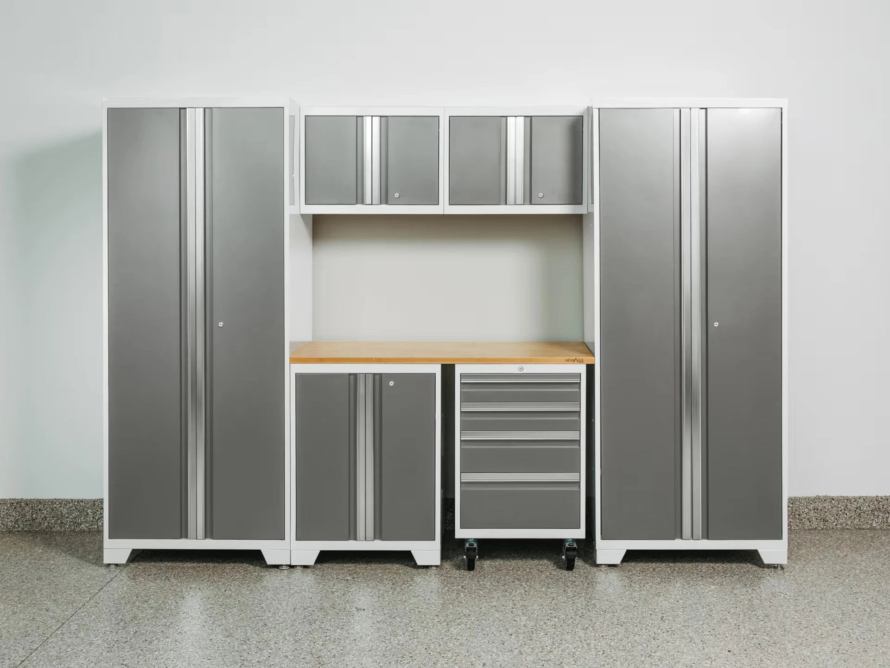
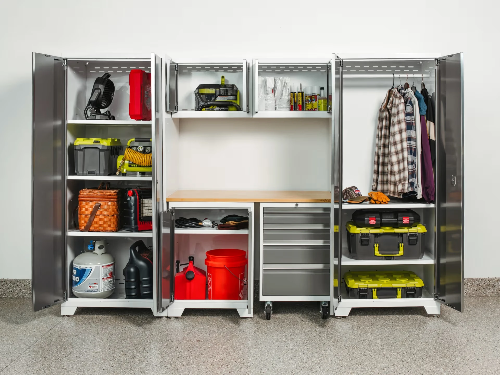
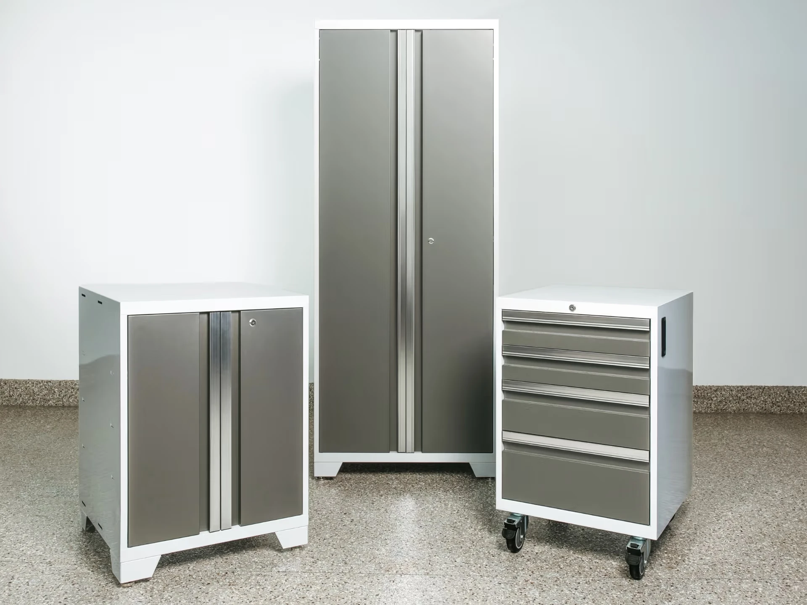
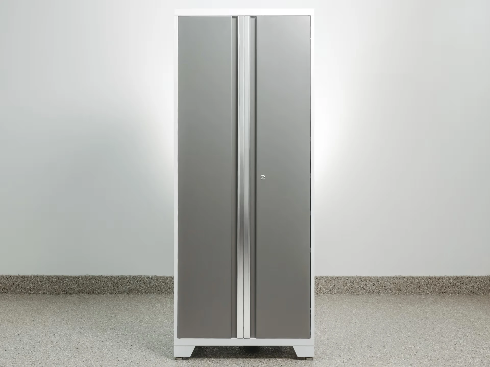
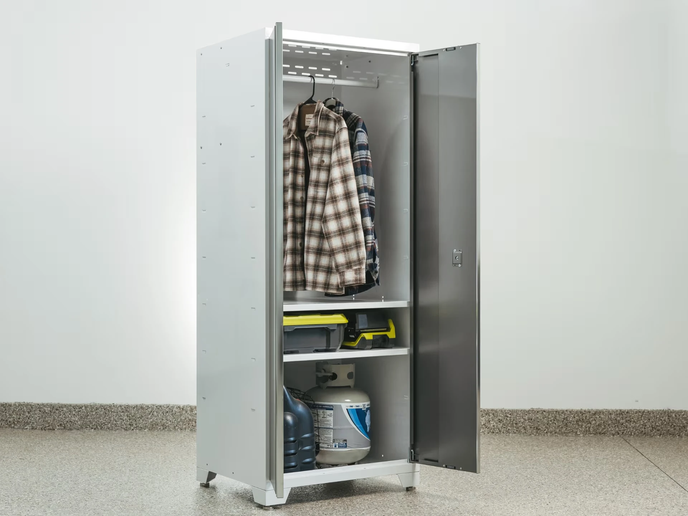
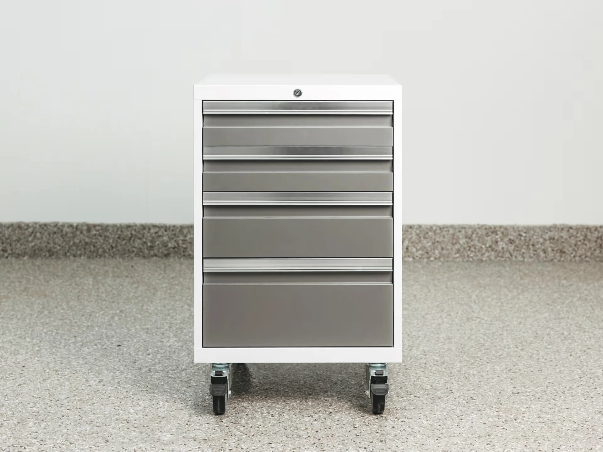
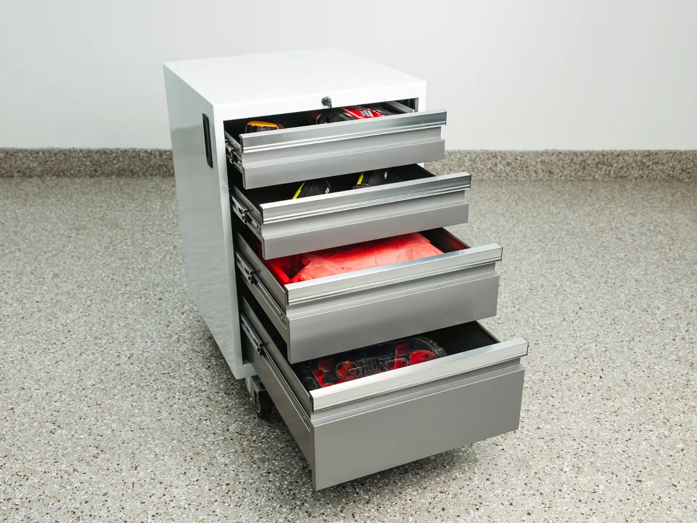
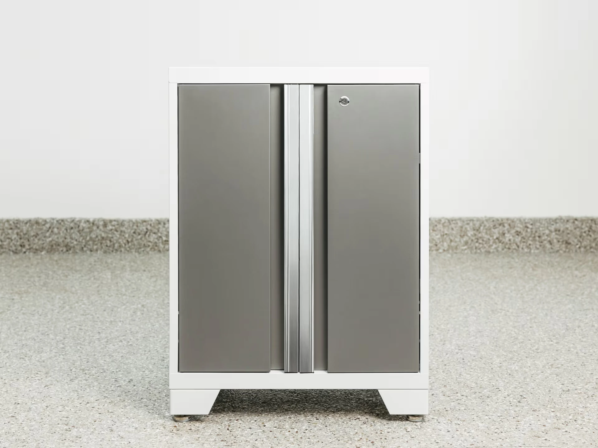
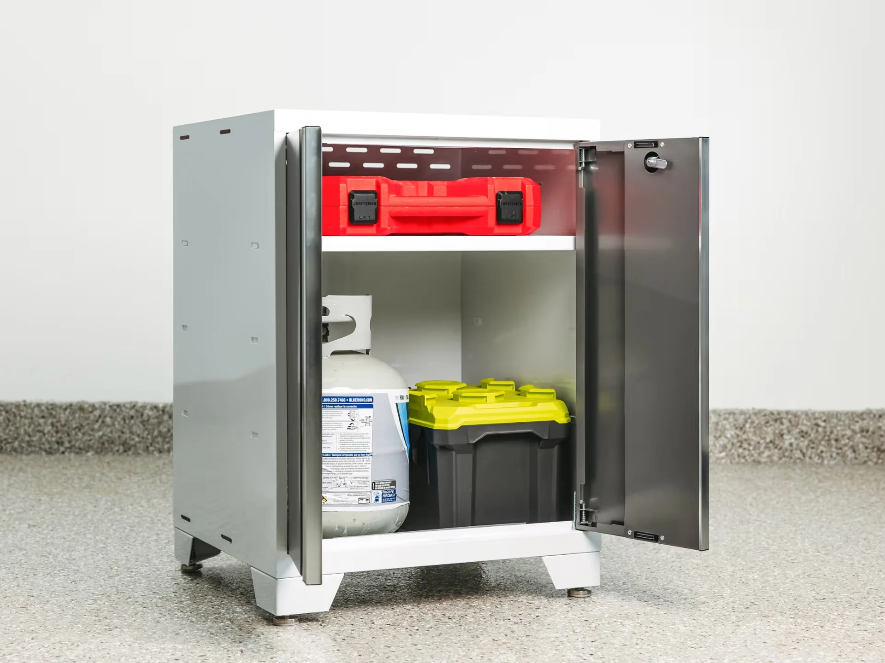
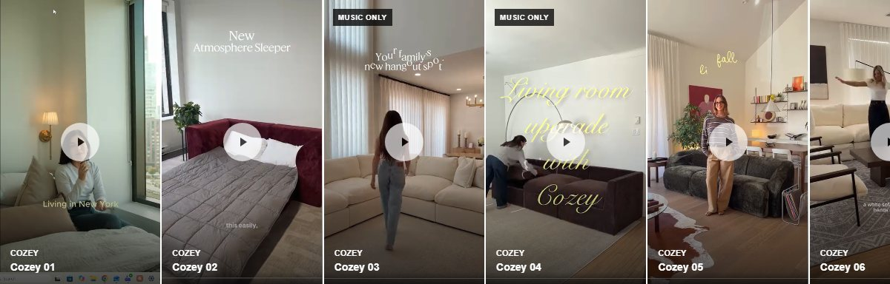

# Weekly Marketing Managers Meeting: November 25, 2026

## General
- Meeting with 5W today to update scope

## NewAge Products
### Weekly highlights
- Assisted with content shoot to update the Bold Series 7PC Garage Cabinetry Set in white/platinum
  - 
  - 
  - 
  - 
  - 
  - 
  - 
  - 
  - 

## Wilder Home
### Weekly highlights
- Influencer outreach to gauge interest and have people ready to go by the time product is available to seed
- Internal "Meta Ad Library": [Wilder Home Creator Content Strategy site](https://bdunn97.github.io/content-strategy-hub-wh/)
  - Easily access competitor ads
  - Acts to inform Wilder Home's creator content approach
  - 

## RST
